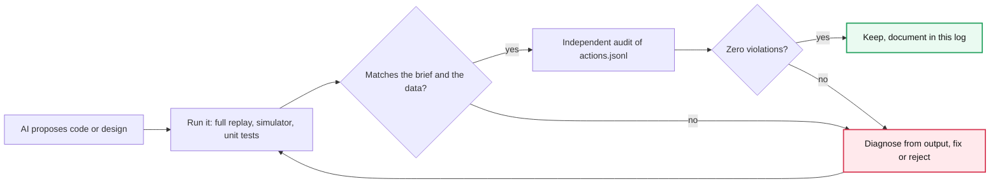

# AI collaboration log

I built this project with an AI assistant (Claude). This log records how it helped, how I checked its output by running it, and what I corrected or rejected.

## The loop I used on every piece of AI-generated code

## How the assistant was used
* Reading the brief, guide and pack, and extracting the traps (duplicates, stale triggers, dialect conflicts, injected description, unmeasurable goals,
  pilot comparison).
* Drafting the module layout and first implementations; generating the synthetic test fixtures.
* **Every claim was checked by running things**: the full replay, the supplied simulator with two seeds, 21 unit tests, and an independent audit of `actions.jsonl`.

## Checks I ran on the AI's output (and what they found)
1. **Goal verifier rejected valid goals.** First run: 11 decisions were `verifier_rejected: eligibility` for G12. Cause: continuing a goal re-ran
   "no app_open in 14 days", which the viewer's own earlier visit now violated. Fix: continued event-based goals are re-checked for measurability only;
   status-based goals (G04/G05/G06/G08/G09) are fully re-checked.
2. **Over-strict `evidence_supported`.** A legitimate G02 proposal was flagged as unsupported because "never completed" has no positive event. Fix:
   G02 now cites the observation window as evidence, and requires *some* evidence the viewer exists (no profile + no signup + no events ⇒ not eligible).
3. **Serialisation bug** in the facts snapshot (sets/datetimes, and a fact without provenance) crashed every agent-arm decision into `internal_error`
   (1,153 fallbacks). The safe fallback worked, but the run proved nothing until fixed.
4. **Withdrawal remediation** rebuilt pages with the *last trigger's* dialect, which can be unusable; fixed to use the page's own dialect.
5. **Test fixture** had no `play_started` events, so every goal was (correctly) "unmeasurable": the measurability logic caught the AI's own fixture.
6. **Priority order** initially put G02 before G03, which left the corrected-rule path with almost no open G03 goals; changed after reasoning about the
   funnel (a just-signed-up viewer's return window closes first).

## Suggestions I rejected (and why)
* **"Compute served vs not-served uplift as the headline."** Rejected: selection bias, exactly the pilot report's mistake. Used intention to treat.
* **"Let the model decide eligibility and trust its confidence."** Rejected: the verifier recomputes eligibility from raw events; the 0.97-confidence
  "billing confirmed" claim from `model_faults.jsonl` is rejected and recorded.
* **"Skip the holdout viewers entirely (no records)."** Rejected: they get a recorded `HOLDOUT_NO_ACTION` and a measurement-only shadow goal so the
  ITT comparison is symmetric; they receive no action and have no viewer state.
* **"Pick the viewer's goal at the latest trigger."** Rejected: later triggers are post-treatment; the assigned goal uses the first fresh trigger.
* **"Use `wa_new_episode_v2` for resuming a series."** Rejected: it claims a *new* episode, which the data cannot support.
* **"Use the profile dialect when the app dialect is missing."** Rejected: the app requests its own setting; a page for another dialect would not be shown.