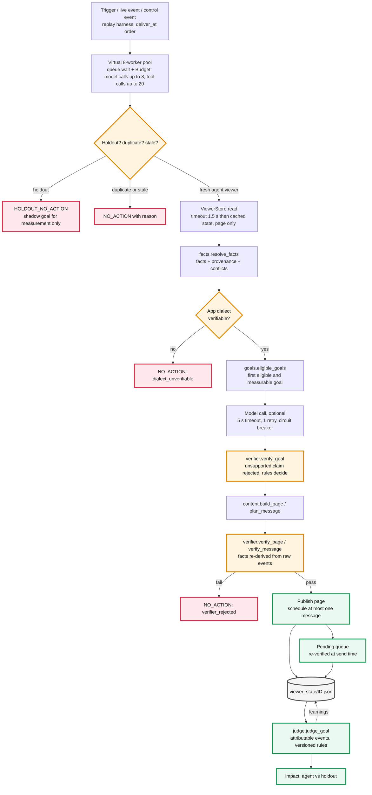
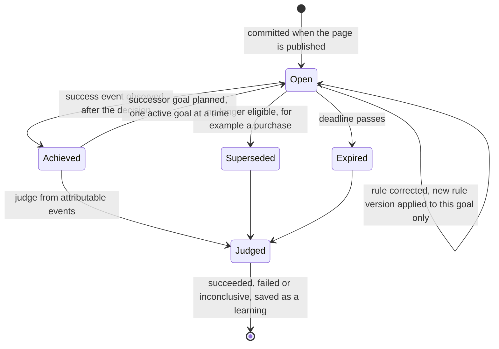
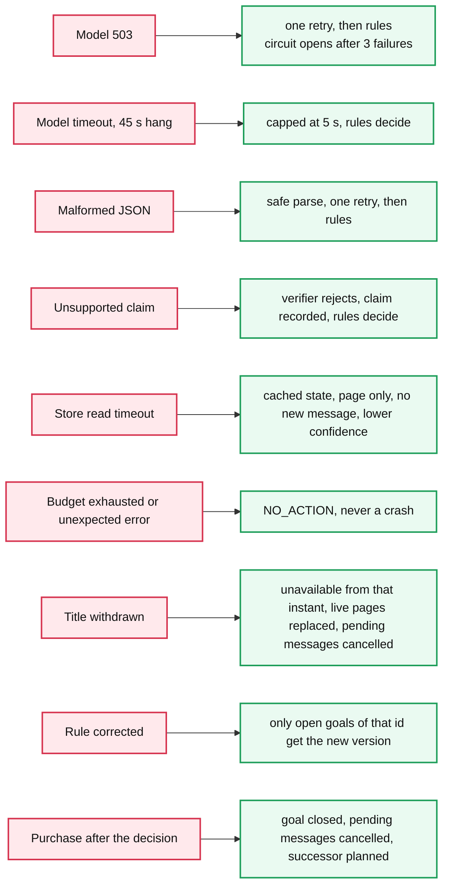

# Architecture

Principle: **deterministic core, model only where it adds information, verifier that can say no.** The model (mock by default) proposes a
goal; it never publishes anything and is never evidence.

### Goal lifecycle

### Failure recovery

## Ownership
One state object per viewer owns exactly one active goal (`state.goal`), its pending messages, live page, goal history, decisions, outcomes and
learnings. Nothing else chooses goals: live events can only *close* a goal (success observed, or no longer eligible after a purchase) and plan
its successor through the same rules.

## Planning
Goal = first goal that is **eligible on evidence and measurable**, in funnel priority `G04 > G01 > G03 > G12 > G02 > G07 > G06 > G05 > G09 > G08`
(time-critical conversion, then activation, then habit). The goal is kept until it succeeds, expires, or (for status-based goals) stops being
eligible. G10 (no success event) and G11 (`tv_app_open` never occurs in the stream) are never chosen. Interpretations of unclear rules (G03, G09, G07, G12)
are in `goals.py` and copied into each decision's `assumptions`.
Intervention: home page for every goal; **one** message only where there is a concrete honest hook (G04 trial ending with a real price, G07 next
episode, G01 first play with the real episode length), on a consented, reachable channel, at the viewer's usual hour, ≥3 h after the visit,
never in quiet hours, never on an IST day that already has a message. Otherwise none. In-app message is the fallback when no channel is consented.

## Source handling (precedence per fact)
| Fact | Rule |
|---|---|
| subscription | newest subscription event beats the profile only if newer than the row's `updated_at`; profile `never` is falsified by any purchase event; otherwise profile wins; conflict kept visible |
| duplicate profile rows | row agreeing with the event-derived status, then latest `updated_at`; dropped row recorded |
| signup | profile value if a row exists, else earliest `signup_completed`; >1 day disagreement logged |
| dialect | **app setting on the trigger** (what the app will request). Profile, last `app_dialect_changed`, campaign deeplink are listed as conflicts. Missing/NA/uncatalogued (d7) ⇒ recorded no-action |
| consent | profile opt-in AND no `notification_opt_out` for the channel at any time; no profile row ⇒ no consent |
| timing | `received_at` orders and ages events; buffered age = `sent_at − occurred_at` (one clock); behaviour time = `received_at − buffered age` |
| freshness | every fact carries `source`, `as_of`, `freshness_s`; confidence is reduced for cache reads, unknown history, conflicts |

## Memory
`viewer_state/<id>.json`: facts+provenance, conflicts, goal, goal history, decisions, actions, messages (pending/sent/cancelled), live page,
outcomes, learnings (e.g. `unreachable_channels`, used by the next plan). `--resume` carries state into the next run.

## Verification (separate module, can reject)
`verifier.py` re-derives facts from raw events and checks: measurable, eligibility (+ `evidence_supported` for model claims), holdout, dialect,
availability at publish/send time (incl. mid-day withdrawal), duplicate slugs, row limits, consent, quiet hours, frequency cap (incl. messages
already delivered in history), copy (lengths, forbidden phrases, prices ∈ pricing.json), template + variable sources, deeplink format,
instruction-like text. A failed check drops that item; if nothing survives the decision is `NO_ACTION` with the reasons.
`audit.py` is a **second, independent** pass over the finished `actions.jsonl` against the raw pack (written separately from the verifier).

## Latency
`published_at = deliver_at + queue wait + modelled dependency latency + measured compute`. A virtual 8-worker pool serves triggers in
`deliver_at` order, so a traffic burst shows up as queue wait. Per-call model timeout 5 s (a 45 s hang costs 5 s), circuit breaker after 3
failures, optional model call skipped when queue wait > 2 s, store read timeout 1.5 s. Stale triggers cost almost nothing (skipped first).

## Failure recovery
Model 503 / timeout / malformed JSON → bounded retry → rules. Unsupported claim → verifier rejects, rules decide, claim recorded. Store
timeout → cached state, page only, lower confidence. Budget exhausted or unexpected exception → `NO_ACTION` (never a crash).
Title withdrawn → availability check fails from that instant, live pages containing it are replaced, pending messages cancelled.
Rule corrected → only open goals of that id get the new rule version (index of open goals), judged under it later.
Purchase after a decision → goal closed, pending messages cancelled, successor goal planned (no new intervention until the next open).

## Trust boundaries
Model output, catalogue text, search queries and deeplinks are untrusted **data**. Descriptions are scanned (`sanitize.py`), logged to
`security_log.jsonl`, and never copied into any message. Deeplinks are parsed with a strict regex; only a title id that passes dialect and
availability checks can become a hero. The pack stays local (no network, no hosted model).

## Measurement
Holdout viewers: no state, no action; a **shadow goal** (same pure rules, first fresh trigger) is recorded for measurement only. Impact =
all agent-arm vs all holdout viewers with an assigned goal (intention to treat), Wald 95% CI, per goal. Goals are assigned at the **first**
fresh trigger by rules from pre-trigger data so that the agent's own actions cannot change who is analysed (post-treatment bias).

## 10 M viewers / 40 dialects
State is per viewer (shard by viewer id; one JSON file → a keyed store). Decisions are independent, so workers scale horizontally; the
catalogue pool per dialect is cacheable; only the per-viewer event window is read. Model calls become optional/batched; the rule path must
meet the SLA alone. Dialects are data (`by_dialect`), not code.