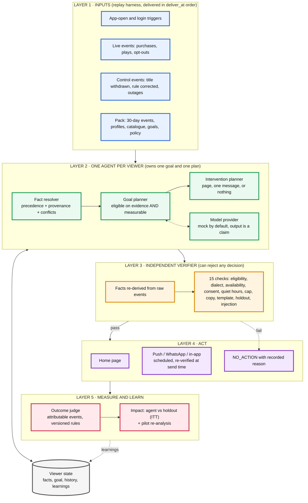
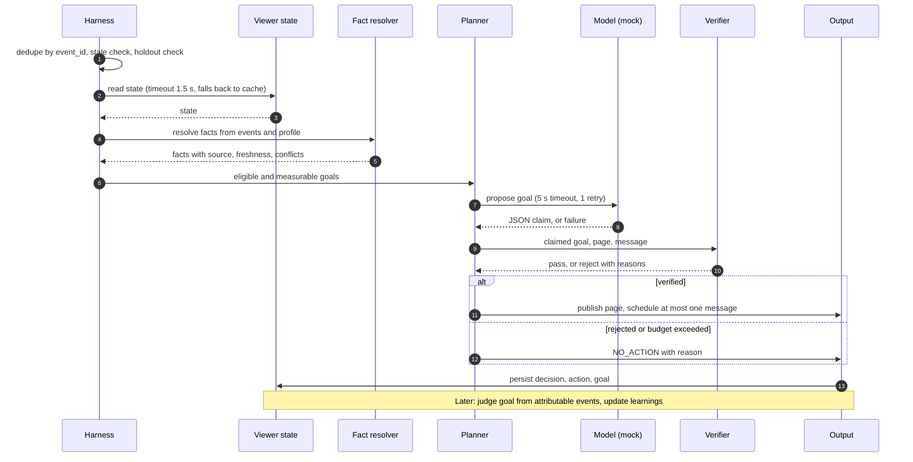

# One User, One Agent

[](#quick-start)
[](#quick-start)
[](#proof-1-the-tests)
[](#proof-2-independent-safety-audit)

A per-viewer agent for a regional-dialect OTT app. On every app open it **understands** the viewer from conflicting sources, **chooses one
measurable goal**, **decides** between a personalised home page, one message, or nothing, **verifies** the decision with an independent checker,
**acts** within a 60-second budget, **judges** the goal later from attributable events, and **proves impact** against a randomised holdout.

Standard library only. Mock model by default: no API key, no network, and no viewer data leaves your machine.

## Results at a glance

| | Result (full replay, 2,679 triggers, 1,746 viewers) |
|---|---|
| Decisions recorded | **2,688**: 887 pages published, 467 agent-arm no-actions (each with a reason), 1,325 holdout (nothing done), 9 re-plan / remediation records |
| Actions released | 895 home pages, 309 push, 82 in-app, 12 WhatsApp |
| Latency (trigger → published) | **p95 0.41 s, max 1.9 s, 0 over 60 s**, busiest 10 minutes (239 triggers) met the budget (dependency latency is modelled; compute time is measured) |
| Safety audit | **1,298 actions re-checked, 0 violations**, 0 actions on holdout viewers |
| Impact, agent vs holdout (ITT) | **+1.3 pp, 95% CI −2.2 to +4.7 pp, p = 0.47**: no reliable effect, reported as such |
| Pilot re-analysis | Report's "+22.4 pp" is selection bias; randomised arms give **−1.3 pp** (CI −3.8 to +1.2) |
| Tests | **21 passing** (late/duplicate triggers, conflicts, failures, corrected rule, safety rules) |

> Honest measurement is the point: the agent shows **no statistically reliable uplift** on this replay, and a second seed (`--seed another-seed`) flips the sign
> of the point estimate to about −1 pp. The system reports that instead of an inflated number.

## Architecture

Mermaid draws flat diagrams, so the layering is shown as stacked, colour-coded bands from inputs down to measurement.



### One trigger, end to end



Design principle: **deterministic core, model only where it adds information, a verifier that can say no.** Full detail, source-handling
rules, goal lifecycle and failure recovery are in [ARCHITECTURE.md](ARCHITECTURE.md).

## Quick start

Python 3.9+ and nothing else. From the project folder (the one that contains `run.py`):

**Windows PowerShell**
```powershell
python run.py all --pack pack --out sample_run
$env:PYTHONPATH = "src"
python -m unittest discover -s tests -v
```

**macOS / Linux**
```bash
python run.py all --pack pack --out sample_run
PYTHONPATH=src python -m unittest discover -s tests -v
```

> **Data pack.** The pack is personal data under the messaging policy, so the raw files are not committed. Put the supplied pack in `pack/`
> with this layout before running: `pack/data/`, `pack/config/`, `pack/replay/`, `pack/pilot/`, `pack/simulator/`.
> Evaluators can point `--pack` at an unseen pack with the same layout and pass `--seed` for a new simulator seed.

| Command | Output |
|---|---|
| `python run.py replay` | `decisions.jsonl`, `actions.jsonl`, `viewer_state/`, `latency_report.json` |
| `python run.py simulate --seed S` | runs the supplied simulator on `actions.jsonl` |
| `python run.py measure` | `outcomes.jsonl`, `impact_report.md` |
| `python run.py all` | everything above, plus `final_report.md` and `audit_report.json` (about 20 s) |

Options: `--seed`, `--pack PATH`, `--set max_model_calls=4 --set max_tool_calls=12` (budgets are configurable), `--config file.json`, `--resume`.

## Proof

### Proof 1: the tests
Real output from a local run, `python -m unittest discover -s tests -v`:

```text
Ran 21 tests in 2.604s

OK
```

| Area | Tests |
|---|---|
| Late / duplicate triggers | duplicate makes no second action · stale offline-buffered trigger skipped · wrong phone clock uses `received_at` |
| Conflicting sources | app-setting dialect wins and conflicts are listed · newer purchase beats stale profile · duplicate profile rows resolved |
| Tool and model failure | model outage → rules · malformed JSON and 45 s timeout → safe fallback · store timeout → cache, page only · tool budget exceeded → no action · unsupported claim rejected |
| Corrected goal rule | only open goals re-evaluated, nobody else reprocessed · judge applies the corrected rule |
| Safety | holdout gets nothing · quiet hours + frequency cap · consent and opt-out override · injected instruction logged, never obeyed · row under 3 titles dropped · withdrawn title not used · unmeasurable goals never chosen · purchase re-plans the goal |

### Proof 2: independent safety audit
`audit.py` is written separately from the verifier and re-checks every released action against the raw pack. `sample_run/audit_report.json`:

```json
{ "actions_audited": 1298, "violations": {}, "holdout_actions": 0,
  "decisions_over_60s": 0, "decisions_total": 2688, "decisions_missing_fields": 0, "passed": true }
```

### Proof 3: one viewer, from app open to judged outcome
Real records from `sample_run/` (viewer `U-00004`, agent arm):

| Time (UTC, 2026-10-01) | Event | What the agent did |
|---|---|---|
| 16:00:18 | `login_success`, app dialect missing | **No action**: `dialect_unverifiable`, it cannot know which dialect the app will request |
| 16:00:19 | `app_open`, dialect d1 | Goal **G07** (resume series `hama-chudibha-d1`, episode 10). Published a home page and scheduled one push. 13 checks passed, 1 model call, 10 tool calls, **414 ms**. Confidence 0.55, with the reason written out |
| 16:13:24 | `app_open` buffered on the phone for 191 s | **No action**: stale trigger, not a live session |
| next day 12:30 | push sent (18:00 IST, outside quiet hours) | scheduled at the viewer's usual hour, re-verified at send time |
| 2026-10-04 16:00 | goal deadline | judged **failed** (no play of the series in the window), recorded in the viewer's learnings |

A failed goal for one viewer is not evidence either way. The honest measure is the holdout comparison below.

### Proof 4: the holdout rule
Viewer `U-00371` (holdout arm), same replay: both triggers produced `status: HOLDOUT_NO_ACTION`, `checks.passed: ["holdout"]`, no viewer state file, no actions.

### Proof 5: impact, measured honestly
Intention-to-treat: every analysed viewer counts in the arm they were randomised to, whether or not the agent acted on them.

| Arm | Viewers with an assigned goal | Reached goal | Rate |
|---|---|---|---|
| Agent | 733 | 100 | 13.6% |
| Holdout | 719 | 89 | 12.4% |
| **Difference** | | | **+1.3 pp, 95% CI [−2.2, +4.7], p = 0.47** |

Pilot re-analysis (`pilot/`): the internal report compared *served* users with *everyone else*.

| Comparison | Group A | Group B | Difference |
|---|---|---|---|
| Report: served vs all others (biased) | 40.1% (87/217) | 17.7% (649/3,674) | +22.4 pp |
| **Randomised: all treatment vs all holdout** | 18.3% (349/1,912) | 19.6% (387/1,979) | **−1.3 pp, CI [−3.8, +1.2]** |

Only 11% of the treatment arm was served, and "all others" mixed the unserved treatment users with the entire holdout. The "roll out to every user" recommendation is not supported.

### Proof 6: data traps found and handled

| Trap | Found | Handling |
|---|---|---|
| Duplicate event ids | 2,176 history, 90 triggers, 7 live | deduped at load and again at runtime (idempotency key = `event_id`) |
| Offline-buffered stale opens | 443 triggers | skipped as live sessions, kept as history |
| Wrong phone clocks | 4,319 events | `received_at` orders and ages events |
| Profile users with two rows | 30 | row agreeing with events, then latest `updated_at`, conflict logged |
| No profile row | 50 viewers, 194 triggers | facts from events; no profile means no consent |
| Unusable app dialect (missing, `NA`, `d7`) | 178 triggers | recorded no-action, never guessed |
| Dialect conflict app / profile / campaign link | 417 decisions | app setting wins, conflicts listed per decision |
| Instruction hidden in a catalogue description | 1 title | logged to `security_log.jsonl`, never obeyed, never copied into copy |
| Unmeasurable goals | G10 (no success event), G11 (`tv_app_open` never occurs) | never chosen |

### Proof 7: replay surprises

| Surprise | Response | Evidence in the run |
|---|---|---|
| Burst of old offline opens | skipped, ingested as history | 201 `stale_trigger` decisions |
| Purchase minutes after a decision | goal closed, pending messages cancelled, successor planned | `REPLAN` record |
| Goal rule corrected mid-replay | new version applied only to open goals of that id | 412 viewers untouched; tests force the open-goal case |
| Model claims eligibility without evidence | verifier rejects, rules decide | 1 unsupported claim recorded |
| Model malformed / timeout / 503 | bounded retry, then rules | 12 × 503, 1 malformed retry, 6 decisions skipped the model while the circuit breaker was open |
| Data store degraded | cached state, home page only, lower confidence | 3 cache fallbacks |
| Title withdrawn | stopped using it, live pages replaced | 8 replacement pages |
| Traffic burst | worker pool, load shedding, no queueing | busiest 10 min (239 triggers): max 0.41 s |

## How the work maps to the evaluation

| Evaluation area | Where to look |
|---|---|
| Goal and decision quality | `src/oua/goals.py`, `content.py`; no-action reasons in `sample_run/final_report.md` |
| Evidence and state | `facts.py`, `sample_run/viewer_state/` (facts carry source, time, freshness) |
| Real-time reliability | `harness.py`, `model.py`, `sample_run/latency_report.json` |
| Verification and safety | `verifier.py`, `audit.py`, `sample_run/audit_report.json`, `security_log.jsonl` |
| Measurement and learning | `judge.py`, `impact.py`, `sample_run/impact_report.md`, learnings in viewer state |
| Engineering quality | `tests/`, one-command run, no dependencies |
| Use of AI tools | [AI_COLLABORATION.md](AI_COLLABORATION.md) |

## Repository layout

```text
README.md  ARCHITECTURE.md  AI_COLLABORATION.md  KNOWN_LIMITATIONS.md
run.py  pyproject.toml  requirements.txt
src/oua/      loader · facts · goals · content · model · verifier · store · harness · latency · judge · impact · audit · report · cli
tests/        unittest suite on a small synthetic pack (runs in milliseconds)
pack/         config/ and simulator/ are included; add data/, replay/, pilot/ locally
sample_run/   decisions.jsonl · actions.jsonl · outcomes.jsonl · viewer_state/ · latency_report.json
              impact_report.md · final_report.md · audit_report.json · cancelled_actions · shadow_goals · security_log · data_issues
```

## Limits worth knowing

* Impact comes from the supplied **simulator**, on one replay day. By-goal cells are small and results move with the seed.
* The mock model proposes the top rule goal, so it adds no information here; a real model would need its own evaluation.
* Dependency latency (model, store, tools) is modelled; only compute time is measured.

Everything left out on purpose is in [KNOWN_LIMITATIONS.md](KNOWN_LIMITATIONS.md).